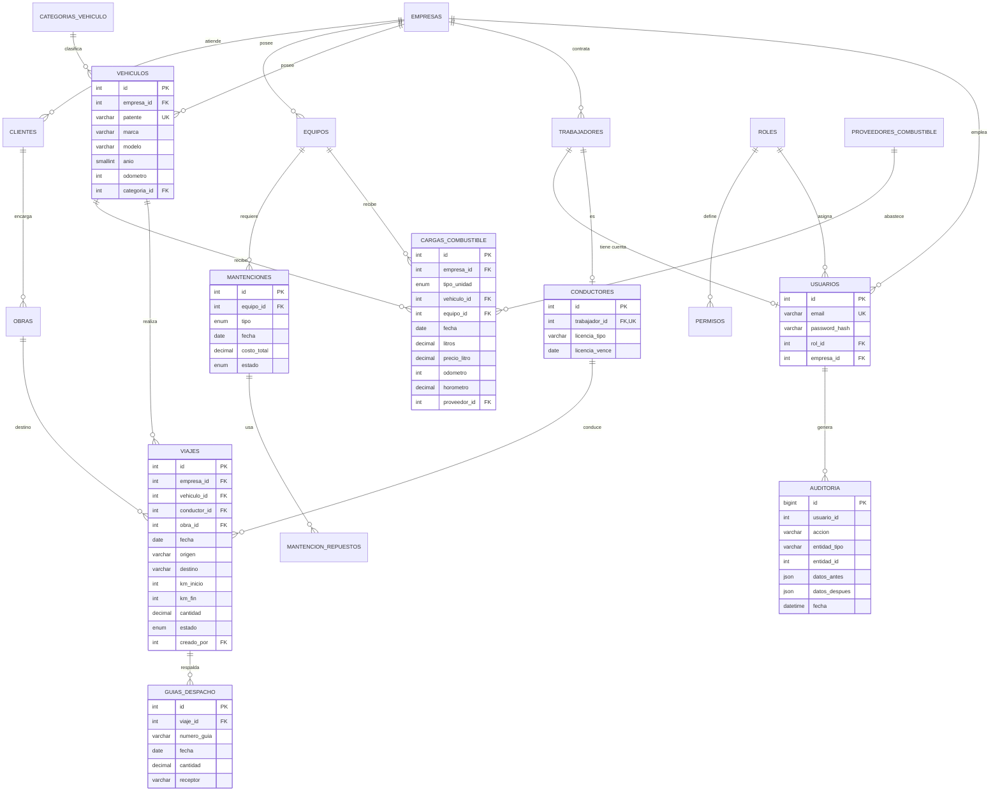

# 02 · Modelo de datos — TriTransportes

Motor: **MariaDB 10.11 / MySQL 8**, InnoDB, `utf8mb4`. El modelo cubre el alcance evaluado: transporte, combustible, flota y seguridad de acceso.

## 1. Diagrama entidad–relación

**Cardinalidades clave:**
- Un vehículo realiza **0..N** viajes y cada viaje tiene **exactamente 1** vehículo y **1** conductor (`NOT NULL`).
- Un viaje puede tener **0..N** guías de despacho.
- Un trabajador es **0..1** conductor (`UNIQUE(trabajador_id)`).
- Una carga de combustible pertenece a un vehículo **o** a un equipo, según `tipo_unidad`. Esta exclusividad se asegura con un `CHECK` (ver §4).

## 2. Diccionario de datos (entidades principales)

### `viajes` — entidad principal (14.792 registros, 12 meses)
| Columna | Tipo | Nulo | Restricción | Descripción |
|---|---|---|---|---|
| id | INT UNSIGNED | No | PK, AI | Identificador |
| empresa_id | INT UNSIGNED | No | FK → empresas | Empresa dueña del registro |
| obra_id | INT UNSIGNED | Sí | FK → obras (SET NULL) | Obra de destino |
| vehiculo_id | INT UNSIGNED | No | FK → vehiculos | Camión que realiza el viaje |
| conductor_id | INT UNSIGNED | No | FK → conductores | Conductor asignado |
| fecha | DATE | No | índice (empresa_id, fecha) | Fecha del viaje |
| hora_salida / hora_llegada | TIME | Sí | CHECK llegada ≥ salida | Horario real |
| origen / destino | VARCHAR(200) | Sí | — | Lugares |
| km_inicio / km_fin | INT UNSIGNED | Sí | CHECK km_fin = 0 OR km_fin ≥ km_inicio | Odómetro |
| cantidad | DECIMAL(10,2) | Sí | CHECK cantidad ≥ 0 | Carga transportada |
| unidad | VARCHAR(30) | Sí | — | m³, ton |
| estado | ENUM | No | programado, en_ruta, completado, cancelado | Estado del flujo |
| creado_por | INT UNSIGNED | Sí | FK → usuarios | Autor (auditoría) |
| created_at / updated_at | DATETIME | No | automático | Trazabilidad |

### `cargas_combustible`
| Columna | Tipo | Nulo | Restricción | Descripción |
|---|---|---|---|---|
| id | INT UNSIGNED | No | PK | Identificador |
| tipo_unidad | ENUM | No | vehiculo, equipo | A qué se carga |
| vehiculo_id / equipo_id | INT UNSIGNED | Sí | FK; CHECK exclusivo según tipo | Unidad abastecida |
| fecha | DATE | No | índice (empresa_id, fecha) | Fecha |
| litros | DECIMAL(10,2) | No | CHECK 0 < litros ≤ 600 | Litros cargados |
| precio_litro | DECIMAL(8,2) | Sí | CHECK precio_litro > 0 | CLP por litro |
| odometro | INT UNSIGNED | Sí | regla de servicio: ≥ último registrado | Km al cargar |
| horometro | DECIMAL(10,1) | Sí | CHECK ≥ 0 | Horas (equipos) |
| proveedor_id | INT UNSIGNED | Sí | FK → proveedores_combustible | Proveedor |

### `vehiculos`
| Columna | Tipo | Nulo | Restricción | Descripción |
|---|---|---|---|---|
| id | INT UNSIGNED | No | PK | Identificador |
| empresa_id | INT UNSIGNED | No | FK; UNIQUE(empresa_id, patente) | Dueño |
| patente | VARCHAR(10) | No | UNIQUE por empresa; CHECK formato | Patente chilena |
| marca / modelo | VARCHAR | Sí | — | Descripción |
| anio | SMALLINT | Sí | CHECK 1980–2100 | Año |
| odometro | INT UNSIGNED | Sí | ≥ 0 | Kilometraje actual |
| activo | TINYINT(1) | No | 0/1 | Baja lógica |

### `conductores`
| Columna | Tipo | Nulo | Restricción | Descripción |
|---|---|---|---|---|
| id | INT UNSIGNED | No | PK | Identificador |
| trabajador_id | INT UNSIGNED | No | FK, UNIQUE | Persona (1:1) |
| licencia_tipo | VARCHAR(10) | Sí | A1–A5, B, C, D | Clase de licencia |
| licencia_vence | DATE | Sí | regla: vigente para programar viajes | Vencimiento |

### `mantenciones`
| Columna | Tipo | Nulo | Restricción | Descripción |
|---|---|---|---|---|
| id | INT UNSIGNED | No | PK | Identificador |
| equipo_id | INT UNSIGNED | No | FK → equipos | Equipo intervenido |
| tipo | ENUM | No | preventiva, correctiva | Tipo |
| estado | ENUM | No | pendiente, en_proceso, completada | Estado del flujo |
| costo_total | DECIMAL(12,2) | Sí | CHECK ≥ 0 | Costo en CLP |

### `usuarios`, `roles`, `permisos`, `auditoria`
- `usuarios.email` es **UNIQUE**, y `password_hash` usa bcrypt (`password_hash`).
- `permisos` tiene la restricción `UNIQUE(rol_id, modulo, accion)`: un permiso no se repite por rol.
- `auditoria` guarda `datos_antes` y `datos_despues` como JSON validado (`CHECK json_valid`).

Las demás tablas de apoyo son `empresas`, `trabajadores`, `clientes`, `obras`, `guias_despacho`, `equipos`, `categorias_vehiculo`, `proveedores_combustible` y `mantencion_repuestos`. Su definición completa está en las migraciones.

## 3. Normalización

- **1FN:** todos los atributos son atómicos; no hay listas en columnas (los repuestos van en su propia tabla, `mantencion_repuestos`).
- **2FN:** todas las tablas tienen una PK simple sustituta, así que no hay dependencias parciales.
- **3FN:** los datos del conductor (nombre, RUT) viven en `trabajadores` y no se repiten en `viajes`; las categorías y los proveedores están en catálogos propios.
- **Desnormalización justificada:** `guias_despacho` copia `vehiculo_id`, `conductor_id`, `cantidad` y `origen/destino` del viaje, porque la guía es un **documento legal** que debe conservar los valores del momento en que se emitió, aunque el viaje cambie después.

## 4. Mejoras planificadas (migraciones del Hito 2)

| Migración | Cambio | Motivo |
|---|---|---|
| `20261110_checks_viajes` | CHECK de km, horas y cantidad | Validación en el tercer nivel |
| `20261110_checks_combustible` | CHECK de litros, precio y exclusividad de vehículo o equipo | Integridad |
| `20261110_check_vehiculos` | CHECK de año y patente | Integridad |
| `20261111_vistas_reportes` | `v_viajes_detalle`, `v_rendimiento_mensual`, `v_kpi_mensual` | Reportes y dashboard |
| `20261111_indices` | `(empresa_id, estado, fecha)` en viajes y `(vehiculo_id, fecha)` en cargas | RNF01: filtros por estado y rendimiento |

Las migraciones se gestionan con **Phinx**. El esquema actual se toma como migración base (`00000000_base`), y cada cambio posterior es una migración versionada con `up()` y `down()`.

## 5. Respaldo y restauración

- **Respaldo:** `mysqldump --single-transaction --routines` diario, comprimido, con 14 días de retención (cron en el servidor; volumen en Docker).
- **Restauración:** `gunzip < respaldo.sql.gz | mysql tritransportes`. El objetivo es restaurar en menos de 15 minutos (RNF07).
- **Prueba:** se registrará en el informe una restauración real, con su fecha y su duración.
