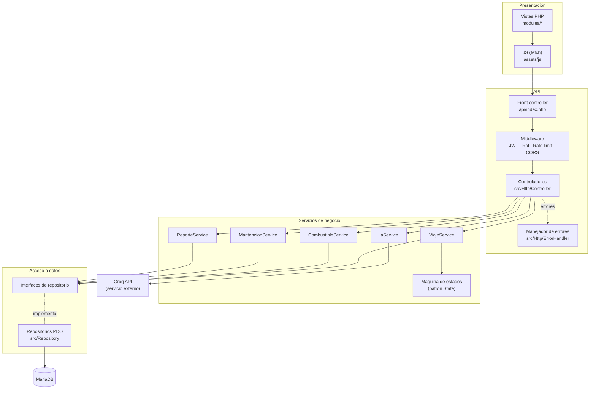
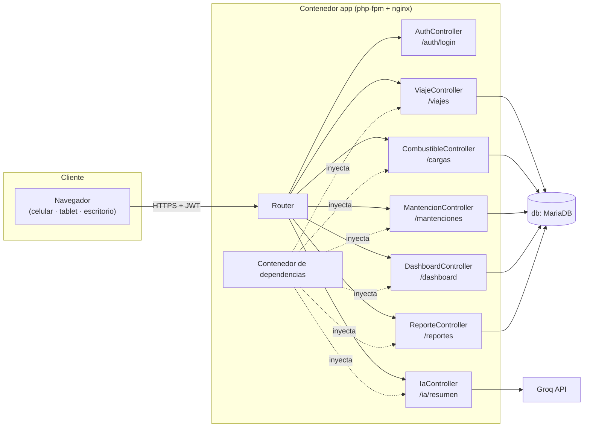
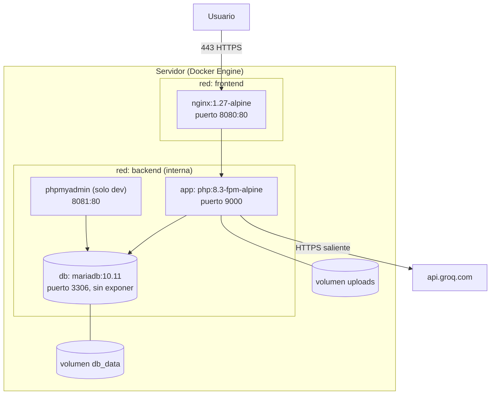

# 03 · Arquitectura de software — TriTransportes

## 1. Visión general

TriTransportes es una aplicación web en **PHP 8.3** con **MariaDB**. El front end se renderiza en el servidor y se apoya en `fetch` para consumir una **API REST con JWT**. El código se organiza en cuatro capas con dependencias en un solo sentido:

| Capa | Carpeta | Responsabilidad | No puede |
|---|---|---|---|
| Presentación | `modules/`, `assets/` | HTML accesible, formularios y validación inmediata | Acceder a la base de datos |
| API | `api/`, `src/Http/` | Rutas, autenticación, autorización, serialización y códigos HTTP | Contener reglas de negocio ni SQL |
| Servicios | `src/Service/`, `src/Domain/` | Reglas de negocio, estados y validación de dominio | Conocer HTTP ni PDO |
| Datos | `src/Repository/` | Consultas SQL preparadas, paginación y filtros | Tomar decisiones de negocio |

## 2. Componentes

## 3. Despliegue

- **Variables de entorno** (sin valores): `APP_ENV`, `APP_URL`, `DB_HOST`, `DB_PORT`, `DB_NAME`, `DB_USER`, `DB_PASS`, `JWT_SECRET`, `JWT_TTL`, `GROQ_API_KEY`, `AI_TIMEOUT`. Están en `.env` (excluido del repositorio) y documentadas en `.env.example`.
- **Demostración pública:** Hostinger (Apache + PHP 8.3 + MariaDB) en `trivoxa.cl/TriTransportes`, con el mismo código y la configuración vía `.env`.

## 4. Requerimientos no funcionales y cómo los atiende la arquitectura

| RNF | Táctica de arquitectura |
|---|---|
| RNF01/02 Rendimiento | Paginación en el repositorio (`LIMIT/OFFSET` con límite de 100), índices compuestos `(empresa_id, fecha)`, vistas SQL de agregación para el dashboard y caché por petición |
| RNF03/04 Seguridad | Middleware JWT (HS256, expiración de 60 min), middleware de rol, alcance por dueño en los repositorios, consultas preparadas, límite de tasa y cabeceras de seguridad |
| RNF05 Secretos | Configuración solo desde el entorno; `.env` está en `.gitignore`; el pipeline usa *secrets* de GitHub |
| RNF06/07 Disponibilidad | Contenedores con `healthcheck` y `restart: unless-stopped`, volumen persistente y respaldo diario |
| RNF10 Mantenibilidad | Capas con dependencias hacia interfaces, inyección de dependencias por constructor y pruebas unitarias de servicios con repositorios falsos |
| RNF12 Resiliencia de IA | `IaService` con timeout, captura de errores y traducción al formato de error estándar (502/504) |

## 5. Seguridad: OWASP API Security Top 10 (2023)

| Riesgo | Mitigación en TriTransportes |
|---|---|
| **API1 BOLA** | Los repositorios filtran siempre por `empresa_id` y, para el rol Conductor, por `conductor_id` del token. Un id ajeno responde 404 |
| **API2 Autenticación rota** | Contraseñas en bcrypt, bloqueo tras 6 intentos fallidos en 15 min y JWT firmado con expiración |
| **API3 Autorización a nivel de propiedad** | Serializadores con lista blanca de campos de entrada y salida (sin `password_hash` ni asignación masiva de `estado` o `empresa_id`) |
| **API4 Consumo de recursos** | Límite de tasa por usuario e IP, `per_page` máximo de 100, tamaño máximo de cuerpo y timeout hacia la IA |
| **API5 Autorización por función** | Middleware de rol por ruta (por ejemplo, `DELETE /usuarios` solo para Administrador) |
| **API8 Mala configuración** | Cabeceras (CSP, HSTS, `nosniff`, `X-Frame-Options`), CORS restringido, errores sin trazas en producción y `.env` bloqueado |
| **API10 Consumo inseguro de APIs** | La respuesta de la IA se valida y se escapa antes de mostrarla; el timeout y los errores están controlados |

## 6. Registro de decisiones (ADR)

### ADR-01 · Patrón Repository
- **Contexto:** el sistema base mezcla SQL en las páginas, lo que impide probar las reglas de negocio y viola la arquitectura en capas.
- **Decisión:** cada agregado (`Viaje`, `CargaCombustible`, `Mantencion`, `Vehiculo`, `Usuario`) tiene una interfaz (`ViajeRepositoryInterface`) y una implementación PDO (`PdoViajeRepository`).
- **Alternativas descartadas:**
  - *Active Record*: acopla el dominio a la base de datos.
  - *ORM Doctrine*: curva de aprendizaje y peso excesivo para 5 semanas.
- **Consecuencias:** los servicios se prueban con repositorios en memoria, y el SQL queda concentrado y revisable.

### ADR-02 · Patrón State para los estados del viaje y la mantención
- **Contexto:** se exige un flujo con estados que impida transiciones inválidas.
- **Decisión:** una clase de estado por valor (`Programado`, `EnRuta`, `Completado`, `Cancelado`) que expone las transiciones permitidas; el servicio pregunta al estado antes de cambiarlo. Una transición inválida lanza `TransicionInvalidaException`, que se traduce a **409**.
- **Alternativas descartadas:**
  - `if/switch` en el controlador: dispersa la regla y no es extensible.
  - Solo un ENUM en la base de datos: no impide saltos como `programado → completado`.

### ADR-03 · Inyección de dependencias con contenedor propio
- **Decisión:** un contenedor mínimo (`src/Container.php`) registra fábricas. Los controladores reciben los servicios y los servicios reciben las interfaces de repositorio, siempre por constructor.
- **Alternativas descartadas:** PHP-DI o Symfony DI, por ser una dependencia adicional; y *service locator* global, porque oculta las dependencias.

### ADR-04 · JWT sin estado para la API
- **Decisión:** `firebase/php-jwt` (HS256). El token lleva `sub`, `rol`, `empresa_id`, `conductor_id` y `exp`.
- **Alternativa descartada:** sesiones PHP, porque no cumplen el requisito y acoplan la API al navegador. Las vistas siguen usando la sesión solo para renderizar la plantilla.

### ADR-05 · Front end renderizado en servidor con fetch
- **Decisión:** se mantienen las vistas PHP con Bootstrap 5 personalizado. Los listados, formularios y el dashboard consumen la API con `fetch`.
- **Alternativa descartada:** una SPA en React, porque duplicaría todo el front end en 5 semanas y aumentaría el riesgo en accesibilidad.

## 7. Principios SOLID visibles en el código

- **S:** `ViajeService` solo contiene reglas de viajes; `ReporteExporter` solo exporta.
- **O:** se agregan nuevos estados o formatos de exportación (`XlsxExporter`, `CsvExporter`, `PdfExporter` con la interfaz `Exporter`) sin modificar a los consumidores.
- **L:** cualquier implementación de `ViajeRepositoryInterface` (PDO o en memoria) es intercambiable en las pruebas.
- **I:** interfaces pequeñas (`ReadRepository` y `WriteRepository`) en lugar de una interfaz gigante.
- **D:** los servicios dependen de abstracciones, y el contenedor resuelve las implementaciones.
